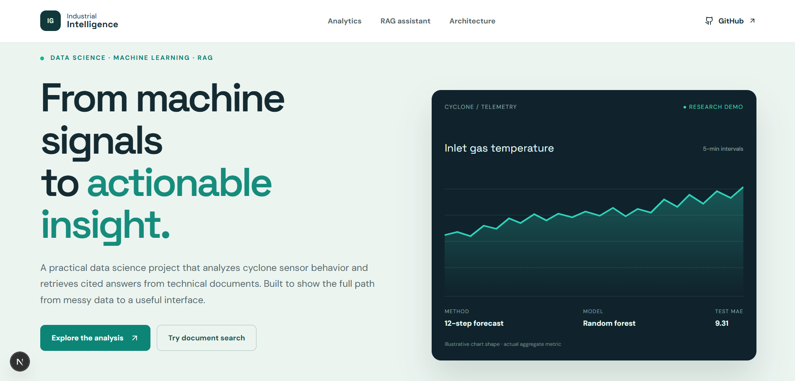
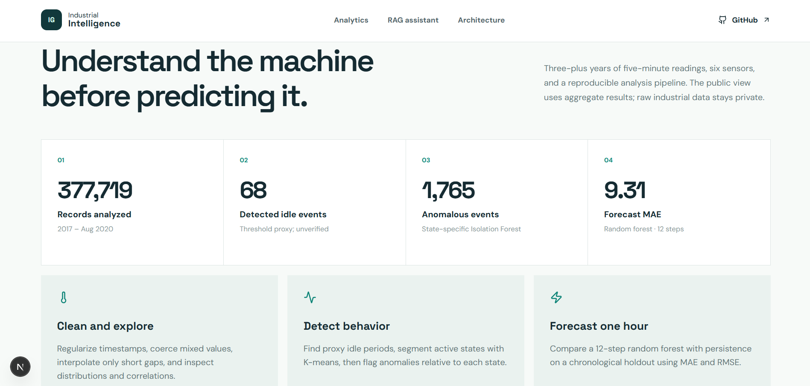
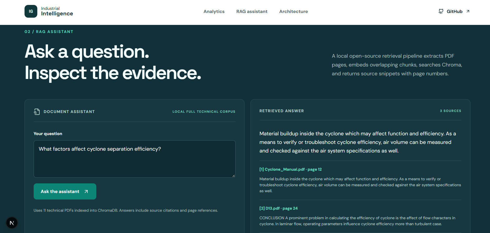
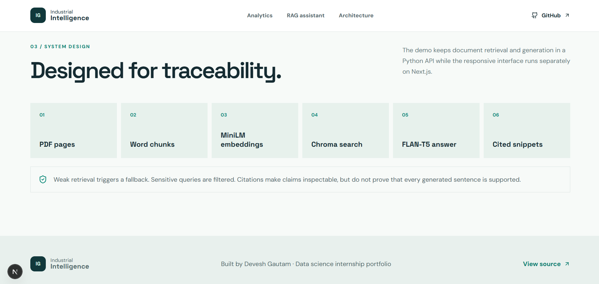
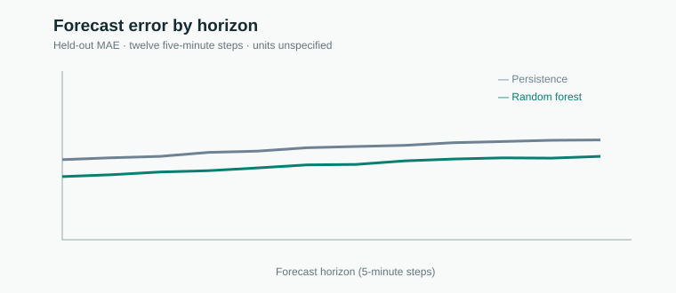
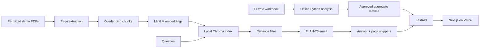

# Industrial Intelligence — Machine Analytics & Cited RAG

[](backend/test_app.py)
[](frontend/package.json)
[](requirements.txt)
[](render.yaml)

**A reproducible cyclone sensor analysis paired with a public document question-answering demo.** Built by Devesh Gautam as a data science internship portfolio project. The analysis studies operating patterns, proxy shutdowns, state-specific anomalies and one-hour temperature forecasts. The app presents aggregate findings and a RAG assistant backed by fictional public sample PDFs.

## Live demo

**Live Website:** [industrial-intelligence-rag.vercel.app](https://industrial-intelligence-rag.vercel.app)  
**GitHub Repository:** [Devesh831/Industrial-Intelligence-RAG](https://github.com/Devesh831/Industrial-Intelligence-RAG)  
**Backend API:** [industrial-intelligence-rag.onrender.com](https://industrial-intelligence-rag.onrender.com)

The frontend is deployed on Vercel and communicates with the FastAPI backend hosted on Render. The public backend uses the documented lightweight RAG mode on the free tier.

## Table of contents

- [Application showcase](#screenshots)
- [Why this project](#why-this-project)
- [What it does](#what-it-does)
- [Measured Task 1 results](#measured-task-1-results)
- [Architecture](#architecture)
- [Stack](#stack)
- [Run locally](#run-locally)
- [Deploy in this order](#deploy-in-this-order)
- [Repository map](#repository-map)
- [Limits and next steps](#limits-and-next-steps)

## Screenshots









## Why this project

Industrial sensor histories are irregular and lack reliable event labels. Operators also need to search long manuals without losing the source of an answer. This project demonstrates an end-to-end approach: make the time series usable, measure model performance on later data, and return retrieved document evidence with page references. The public demo avoids exposing the supplied workbook or restricted manuals.

## What it does

| Machine analytics | RAG assistant |
| --- | --- |
| Builds a strict five-minute timeline and audits missing values | Extracts text page by page from PDFs |
| Finds low-temperature/low-draft periods with an explicit proxy rule | Splits pages into overlapping chunks and embeds them with MiniLM |
| Clusters active sensor readings with K-means | Searches a local Chroma vector index |
| Detects anomalies separately within each cluster | Full local mode uses FLAN-T5-small; Render Free uses a labeled lightweight extractive mode, with filename, page and snippet |
| Compares persistence and a 12-step random forest on later data | Falls back when retrieval is weak and filters selected sensitive queries |

## Measured Task 1 results

The supplied workbook contains **377,719 readings** from **1 January 2017 to 7 August 2020**, with **861 missing five-minute timestamps**. The analysis detected **68 proxy shutdown events / 5,402 hours** across the full available period and **1,765 anomaly events**. Restricting shutdown overlap to the three full calendar years 2017–2019 yields **65 events / 4,487 hours**. These are threshold-based findings, not confirmed plant logs.

The one-hour forecast uses **6,268 later, fully observed hourly origins**. Across all 12 horizons, persistence scored **MAE 11.42 / RMSE 20.11**; the random forest scored **MAE 9.31 / RMSE 16.94**. The dataset does not specify physical measurement units.



The public chart reports only aggregate error. Local analysis outputs include the one-week and one-year time-series views, highlighted shutdown periods and four anomaly context plots. See [Task 1 methods](Task1/README.md) and `Task1/findings.md` in the private submission for event hypotheses and caveats.

## Architecture



The same flow is provided as an editable [PowerPoint architecture diagram](Task2/architecture_diagram.pptx). The public corpus is generated by `Task2/prototype/make_demo_docs.py`; those documents are explicitly fictional. **No RAG answer or screenshot is presented as validated operational advice.** A real assistant response must be checked against its cited page.

## Screenshots

These captured views show the actual portfolio interface. The RAG screenshot deliberately labels its source as a fictional public sample.


## Stack

Python, Pandas, NumPy, Scikit-learn, Matplotlib, FastAPI, Pydantic, pypdf, Sentence Transformers, Chroma, Hugging Face Transformers, PyTorch, Next.js, React and TypeScript. The frontend is prepared for Vercel; the Dockerized API is prepared for Render.

## Run locally

1. Install Python 3.11+ and Node.js 20+. Create a Python environment and run `pip install -r requirements.txt` for analysis or `pip install -r backend/requirements.txt` for the web API.
2. For the private machine analysis, run `python Task1/task1_analysis.py path/to/data.xlsx` and `python Task1/validate_outputs.py`. The raw workbook is not included in Git.
3. Start the public API with `uvicorn backend.app:app --port 7860`. The first start downloads the free models and creates fictional demo PDFs. Check `http://localhost:7860/health`.
4. In `frontend`, copy `.env.example` to `.env.local`, run `npm install`, then `npm run dev`. Open `http://localhost:3000`.
5. Run `python -m pytest backend/test_app.py Task2/prototype/test_rag.py -q` and `npm run build` before deployment.

## Deploy in this order

### 1. Render backend

1. In Render, choose **New → Web Service**, connect GitHub and select `Devesh831/Industrial-Intelligence-RAG`.
2. Use the checked-in `render.yaml` as the Blueprint, or configure the service manually with Docker runtime, root directory `.`, root `Dockerfile`, and Free plan. The root Dockerfile installs `backend/requirements.txt`, copies only `Task2` and `backend`, and listens on Render's injected `PORT` (falling back to 7860 locally). `.dockerignore` excludes `frontend`, `Task1`, private PDFs, spreadsheets, generated plots and local caches.
3. Set `FRONTEND_ORIGINS` to the exact Vercel origin you will use later. Before the frontend exists, use `http://localhost:3000`; update it and redeploy after Vercel is created.
4. Set the Render health check path to `/health`. The FastAPI lifespan yields immediately so the process binds Render's port before a background worker builds Chroma. Free-tier deployments keep `ENABLE_LOCAL_MODELS=false`, using lightweight hash retrieval and extractive cited answers; set it to `true` only on a larger host. Render should route traffic only when this endpoint returns 200 with `status: "ready"`, `models_ready: true` and `index_ready: true`.
5. Verify `GET https://YOUR-SERVICE.onrender.com/analytics`. Verify `POST /ask` with JSON such as `{"question":"What does the public demo document say about a draft drop?"}`. A 503 while health is `starting` is expected; inspect Render logs if it remains 503 after model loading.

### 2. Vercel frontend

1. Import the same GitHub repository into Vercel.
2. Set **Root Directory** to `frontend`. Vercel will use `frontend/vercel.json`, `npm install --no-audit --no-fund` and `npm run build`.
3. Add the Production environment variable `NEXT_PUBLIC_API_BASE_URL=https://industrial-intelligence-rag.onrender.com`. Redeploy after changing it; the browser needs the value at build time. For local development, copy `frontend/.env.example` to `frontend/.env.local` and use `http://localhost:7860` only when running the backend locally.
4. Open the Vercel preview first and verify the analytics section loads, the assistant returns citations, and browser requests do not show CORS errors. Then promote the tested deployment.
5. Replace the `Live app` placeholder near the top of this README only after the Vercel URL and its API calls have been tested. Do not publish a placeholder as if it were live.

If a local browser shows `__webpack_modules__[moduleId] is not a function` or the server reports missing files under `.next`, stop all dev/build processes, remove the generated `frontend/.next` directory, and run `npm run dev` again. Do not run `next build` concurrently with `next dev`, because both mutate `.next`. The development script uses Next's Turbopack path to avoid stale Webpack HMR module tables. This is a generated-cache issue; the production build is independently verified.

If the Render service sleeps, allow roughly a minute for a cold start before retrying. Render Free web services spin down after inactivity and use an ephemeral filesystem, so the Hugging Face model cache and Chroma index may be downloaded or rebuilt after restarts. Render persistent disks are not available on Free web services; this demo intentionally rebuilds its small fictional index at startup. The free instance's memory and CPU may be insufficient for larger models or a large corpus. Render describes these constraints in its [free service documentation](https://render.com/docs/free), [filesystem documentation](https://render.com/docs/disks), and [health check documentation](https://render.com/docs/health-checks).

`FRONTEND_ORIGINS` is an exact CORS allowlist. The browser-facing API URL is public by design and must not contain credentials. Keep service tokens only in server-side secrets if a future feature needs them. See [backend instructions](backend/README.md) and [RAG instructions](Task2/prototype/README.md).

## Repository map

```text
frontend/             Next.js portfolio UI and public aggregate chart
backend/              FastAPI public demo and Docker requirements
Task1/                Reproducible private-data analysis and validators
Task2/prototype/      Reusable local PDF RAG logic and fictional demo generator
Task2/notes.md        Retrieval, guardrail and scaling trade-offs
Dockerfile            Render Docker deployment entry point
```

## Limits and next steps

Shutdown events are proxy labels; the model needs operator logs to measure detection accuracy. The RAG distance threshold is uncalibrated, and the small local generator can repeat snippets or make unsupported claims. Some PDFs need OCR, and the supplied corpus mixes industrial and weather-cyclone documents. Before operational use, curate the corpus, add labeled retrieval questions, measure faithfulness and abstention, verify citations sentence by sentence, and test capacity with concurrent users. The portfolio demonstrates methods and transparent limitations; it is not a plant control system.
